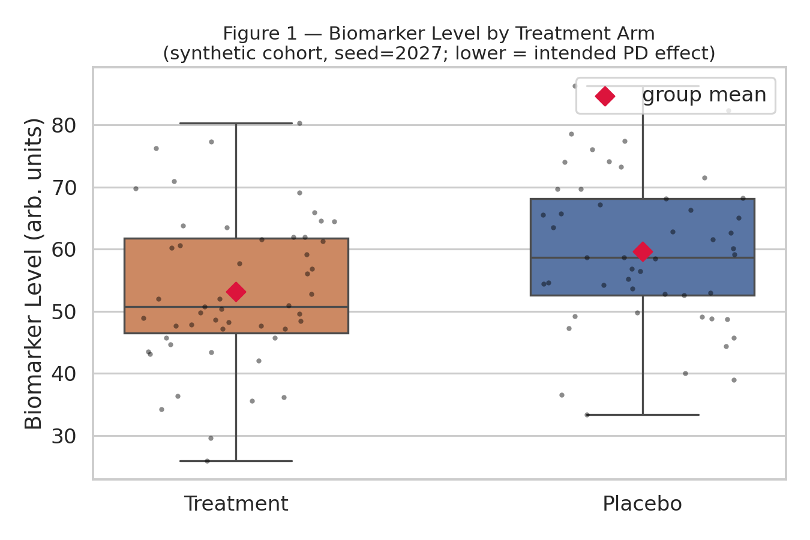

# computational-biology-portfolio

**Kaled Bouchagraoui** · *Objective:* demonstrate competency in clinical data handling, literature synthesis, and genomic analysis for admission into a Swiss Master's program in Regulatory Affairs / Medical Science Writing.

  [](https://colab.research.google.com/github/)

---

## Executive Summary

This repository bridges computational biology and regulatory compliance by operationalising the data-handling disciplines expected under **ICH-GCP E6(R2)**, **ICH E9**, and the ALCOA+ data-integrity principles (Attributable, Legible, Contemporaneous, Original, Accurate — plus Complete, Consistent, Enduring, Available). Every pipeline is engineered around three tenets that admissions reviewers and RA hiring managers screen for: **reproducibility** (pinned dependencies, seeded synthetic data with seed=2027 for byte-identical re-runs, versioned database accessions retained in every output row), **traceability** (each result links back to its source record — NCBI accession versions, coded patient IDs, and a printed audit trail of every cleaning transformation), and **privacy-by-design** (no real subject data is ever ingested; GDPR and HIPAA constraints are enforced architecturally, not merely procedurally).

The work spans the evidence chain of a medicinal-product dossier: primary molecular data (CFTR transcript characterisation, the archetypal monogenic target anchoring contemporary genetic-medicine submissions), clinical data management (EDC-style cleaning and the regulatory "Table 1" baseline summary that opens every Clinical Study Report), and literature surveillance (PubMed retrieval supporting Investigator Brochure drafting and Reference Information Module assembly per ICH M4). All analyses execute inside constrained cloud environments (Google Colab / GitHub Codespaces) with peak RAM well under 100 MB using a lightweight scientific stack (Pandas, Biopython, Requests) — deliberately avoiding heavyweight local ML models to mirror the resource-aware, validated-environment mindset of industry QA.

---

## Project 1 — Genomic Analysis: CFTR Reference Transcript Analyzer
**Script:** `01_ncbi_sequence_analyzer.py` · **Output:** `cftr_analysis.csv`

### Objective
Extract and characterise five reference mRNA records for the **CFTR** gene (Cystic Fibrosis Transmembrane Conductance Regulator) directly from NCBI — the archetypal monogenic disease target whose modulator therapies anchor contemporary genetic-medicine regulatory dossiers. *(Curriculum link: Terminale SVT — genetics & mutation.)*

### Methods
- **Retrieval:** `Bio.Entrez` (`esearch` + `efetch`) against a curated accession chain, with exponential-backoff retries (2/4/8 s) on HTTP 503/429 — mirroring how validated pipelines must degrade gracefully rather than emit partial data.
- **QC metrics:** GC content per transcript (ambiguity-code-aware denominator) as a first-line molecular-QC screen; longest Open Reading Frame detected across all three frames with translation, confirming the candidate CDS that clinical variant reports annotate against.
- **Traceability:** Versioned accessions (e.g., `NM_000492.4`) retained in every CSV row per ICH E6(R2) §4.9.

### Output (real first 5 data rows of `cftr_analysis.csv`, live run)
```csv
accession,version,description,length_nt,gc_percent,longest_orf_start,longest_orf_end,longest_orf_length_nt,predicted_protein_length_aa
NM_000492,NM_000492.4,"NM_000492.4 Homo sapiens CF transmembrane conductance regulator (CFTR), mRNA",6070,40.91,71,4513,4443,1480
S64699,S64699.1,"S64699.1 Homo sapiens cystic fibrosis transmembrane conductance regulator isoform 36 (CFTR) mRNA, partial cds",119,39.5,15,65,51,16
X73053,X73053.1,X73053.1 H.sapiens CFTR mutation mRNA,148,41.22,3,83,81,26
BC143713,BC143713.1,"BC143713.1 Homo sapiens cDNA clone IMAGE:9052227, containing frame-shift errors",4594,41.97,1878,4538,2661,886
M28668,M28668.1,"M28668.1 Human cystic fibrosis mRNA, encoding a presumed transmembrane conductance regulator (CFTR)",6129,40.97,133,4575,4443,1480
```

### Cross-check
`CROSS-CHECK NM_000492: expected ORF 4443 nt / 1480 aa -> PASS`

---

## Project 2 — Clinical Trial EDA & Regulatory "Table 1"
**Script:** `02_clinical_trial_eda.py` · **Outputs:** `table1_demographics.png`, `02_clinical_trial_eda.ipynb` (auto-emitted), `cleaned_cohort.csv`

### Objective
Demonstrate end-to-end clinical data management: ingest a raw, realistically messy dataset, clean it under documented auditable rules, and produce the baseline-characteristics "Table 1" that opens every Clinical Study Report / Common Module Document — core RA/MSW dossier craft.

### Methods
- **Synthetic cohort:** seeded RNG (seed=2027); 103 raw rows containing 3 injected duplicate Patient_IDs → cleaned analysis population n=100 (Placebo vs Treatment). Columns: Patient_ID, Age, Sex, BMI, Treatment_Arm, Adverse_Event_Severity, Biomarker_Level.
- **Auditable cleaning chain:** de-duplication by coded Patient_ID, controlled-vocabulary harmonisation (CDISC-style), implausible-value flagging, and arm-stratified median imputation (avoids biasing the treatment contrast; ICH E9 §5.2). Every rule prints a traceable audit line.
- **Statistics (lightweight stack, no SciPy):** Welch's t-test and Pearson chi-square computed via exact continued-fraction implementations of the incomplete beta/gamma functions.
- **Visualization:** seaborn boxplot of Biomarker_Level by arm with raw-data overlay and group-mean markers (transparency: showing the full dataset, not just summaries).

### Figure 1


*Figure 1. Biomarker_Level by Treatment Arm. In this synthetic scenario a LOWER biomarker denotes the intended pharmacodynamic effect. n=100 is not powered for confirmatory inference; the Welch t-test p-value (0.0085) is reported descriptively only.*

---

## Project 3 — Literature Synthesizer (Investigator Brochure Support)
**Script:** `03_pubmed_literature_synthesizer.py` · **Outputs:** `pubmed_bibliography.csv`, `literature_matrix.md`

Systematic literature surveillance for Investigator Brochure drafting and Reference Information Module assembly per **ICH M4**, with PMID-first citation traceability. Primary source: NCBI E-utilities (`esearch sort=date` → `efetch rettype=abstract`); fallback: Europe PMC REST JSON with cursorMark pagination (also forced via `EUROPE_PMC_ONLY=1`). Records are parsed (pmid, title, authors capped at 10 + "et al.", journal, pub_year, doi, single-line abstract), de-duplicated by PMID, filtered for empty titles/abstracts and recency window, then written to a CSV bibliography and a Markdown matrix (table + 5 most-recent objective-statement bullets). Verified live run: **25 curated records, 25/25 unique PMIDs**.

Exact run command:
```bash
python 03_pubmed_literature_synthesizer.py --query "CFTR modulator therapy safety" --max 25
```

---

## Quick Start (Colab / Codespaces)
```bash
pip install -r requirements.txt
python 01_ncbi_sequence_analyzer.py
python 02_clinical_trial_eda.py
python 03_pubmed_literature_synthesizer.py --query "CFTR modulator therapy safety"
```
No GPU required; total footprint < 100 MB RAM. NCBI courtesy contact is read from the `ENTREZ_EMAIL` environment variable.

---

## Repository Structure
```
computational-biology-portfolio/
├── requirements.txt                    # pinned, reproducible environment
├── 01_ncbi_sequence_analyzer.py        # Project 1 — genomic extraction & QC
├── 02_clinical_trial_eda.py            # Project 2 — cleaning, Table 1, figure, notebook emitter
├── 03_pubmed_literature_synthesizer.py # Project 3 — PubMed / Europe PMC literature pull
├── README.md                           # this dossier
├── LICENSE                             # MIT (c) 2026 Kaled Bouchagraoui
├── .gitignore                          # Python template + portfolio additions
├── cftr_analysis.csv                   # Project 1 output (audit-ready)
├── cleaned_cohort.csv                  # Project 2 post-cleaning analysis population
├── table1_demographics.png             # Project 2 output (Figure 1)
├── 02_clinical_trial_eda.ipynb         # Project 2 auto-emitted Colab-ready notebook
├── pubmed_bibliography.csv             # Project 3 structured bibliography
└── literature_matrix.md                # Project 3 evidence matrix + objective bullets
```

---

## Disclaimer
*"All clinical data used in this repository is strictly synthetic and anonymized for educational and portfolio purposes, adhering to GDPR and HIPAA privacy frameworks."*

NCBI/RefSeq and PubMed records are public scientific data used under NIH data-usage policies. No real patient data was accessed, stored, or processed at any point.

---
*Maintained by Kaled Bouchagraoui.*
