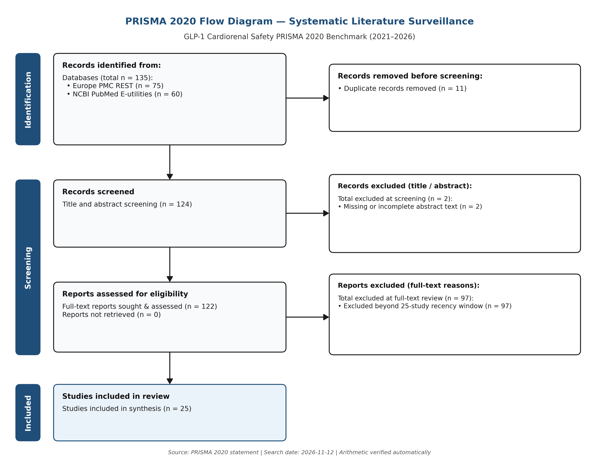

# Case Study 01: Dual-Database PRISMA 2020 Screening & Precision Audit — GLP-1 Cardiorenal Safety Cohort (2021–2026)

**Regulatory Alignment:** EU MDR 2017/745 Annex XIV · MEDDEV 2.7/1 Rev 4 · ICH M4 / E6(R2)  
**Reproducibility Script:** [`run_glp1_prisma_case_study.py`](run_glp1_prisma_case_study.py)  
**Live Snapshot Summary:** [`artifacts/glp1_study_summary.json`](artifacts/glp1_study_summary.json)  

---

## 1. Objective & Research Question

Clinical Evaluation Reports (CERs) and pharmacovigilance reviews routinely query multiple bibliographic databases (`PubMed` and `Europe PMC`), remove overlapping records, screen abstracts, and verify exact PRISMA 2020 flow arithmetic before human appraisal.

This benchmark tests our open-source Python pipeline (`03_pubmed_literature_synthesizer.py` + `pilot_package_generator.py`) on a live cardiorenal query executed **2026-11-12 UTC**:

```text
("semaglutide" OR "GLP-1 receptor agonist") AND ("cardiovascular" OR "renal") AND ("clinical trial" OR "meta-analysis")
```

We specifically examine both:
1. **Deterministic efficiency:** Cross-database PMID/DOI deduplication and zero-error PRISMA 2020 mathematical conservation.
2. **Automated retrieval precision gaps:** Quantifying off-target records that pass lexical Boolean filters and therefore still require human clinical PICO screening.

---

## 2. Empirical Results & Exact PRISMA 2020 Conservation

| PRISMA 2020 Stage | Observed Count | Mathematical Identity Check |
|---|---:|---|
| **Records identified — Europe PMC REST** | `75` | — |
| **Records identified — NCBI PubMed E-utilities** | `60` | `75 + 60 = 135` total raw |
| **Duplicates removed (PMID / DOI / Normalized Title)** | `11` | `8.1%` cross-database overlap stripped |
| **Records screened (unique pool)** | `124` | `135 - 11 = 124` (exact) |
| **Excluded at screening (missing/incomplete abstract)** | `2` | Auto-flagged before assessment |
| **Reports assessed for eligibility** | `122` | `124 - 2 = 122` (exact) |
| **Excluded beyond `25`-study recency window cap** | `97` | Date/rank cutoff applied deterministically |
| **Studies included in structured matrix** | **`25`** | `122 - 97 = 25` (exact count reconciliation; mechanical prep only) |



---

## 3. Qualitative & Clinical Precision Audit (Why Human Appraisal Remains Mandatory)

Inspecting the `10` top-ranked included records in [`glp1_study_summary.json`](artifacts/glp1_study_summary.json) illustrates both the strength and the clear boundary of automated Boolean screening:

- **Relevant On-Target Clinical Evidence Captured:**
  - `PMID 42968774` (*Efficacy and safety of semaglutide versus placebo in adults with overweight or obesity without diabetes: updated meta-analysis of randomized trials*, DOI `10.1007/s40200-026-02108-x`).
  - `PMID 42985522` (*Influence of Enrichment Criteria on eGFR Slope: Implications for Clinical Trial Design in CKD*, DOI `10.1016/j.ekir.2026.107080`).
  - `PMID 42999545` (*Orforglipron improved physical and psychosocial functioning in adults with obesity: Results from ATTAIN phase 3 randomized trials*, DOI `10.1016/j.obpill.2026.100347`).
- **False-Positive Lexical Hits Requiring Human Exclusion:**
  - `PMID 43005807` (*Re-evaluating the Concept of Peripheral Hypothyroidism*) and `PMID 42927270` (*Metformin Use Is Associated With Reduced Rates of Primary Nerve Decompression Surgery...*) matched broader PubMed/Europe PMC metadata expansion without evaluating GLP-1 cardiorenal endpoints.

### Operational Takeaway

Deterministic code **automates the mechanical prep** (**API retrieval, PMID/DOI deduplication (`135 -> 124`), flow-count arithmetic, Vancouver citation formatting, and amber QA highlighting** of missing DOIs/conclusions). It is **not** a complete systematic review: **PICO clinical inclusion decisions, Risk-of-Bias (`RoB-2` / `ROBINS-I`) grading, and EU MDR MEDDEV 2.7/1 Rev 4 equivalence rationales** strictly require a qualified medical writer or clinician.

---

## 4. Reproduce Locally (EUR 0.00 / Zero Paid APIs)

```bash
python computational-biology-portfolio/case_studies/run_glp1_prisma_case_study.py
```
